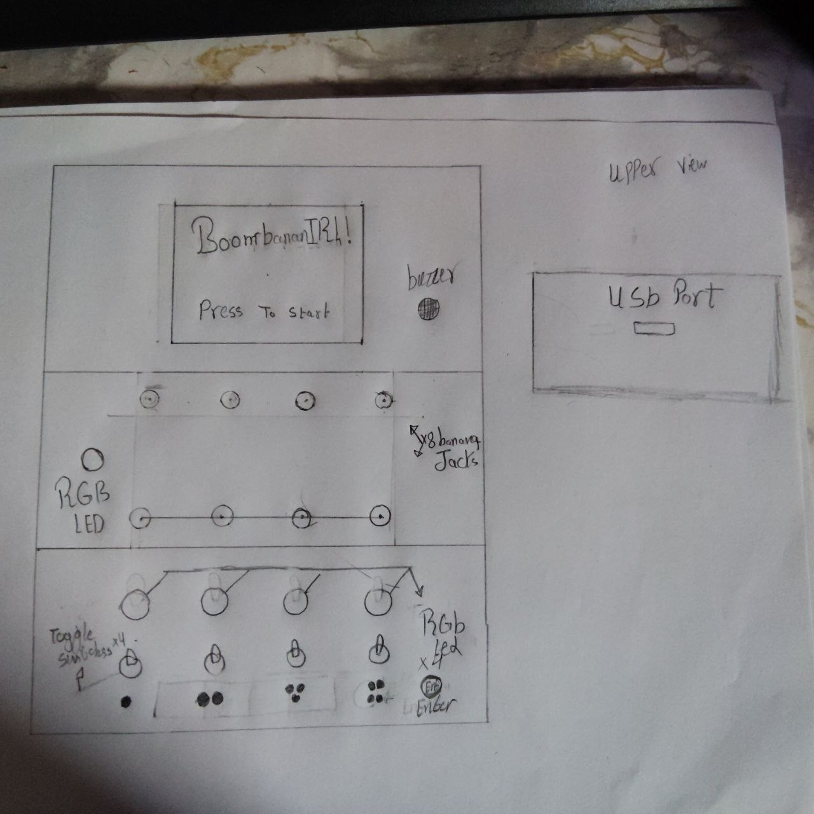
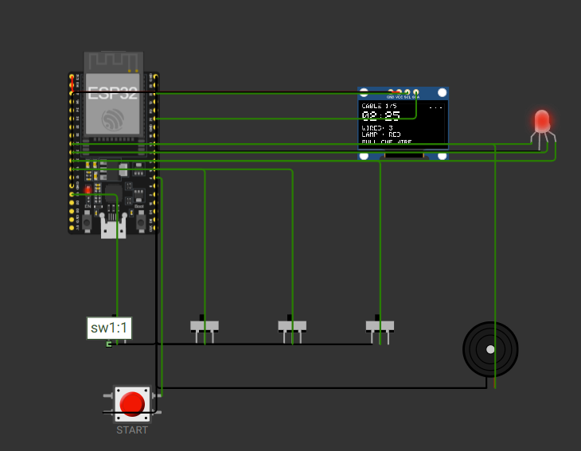

# November 2: Paper prototype and first plan:

I played a paper version of the game and it was exciting and wonderful,
I also wanted to test the game before developing it to see if its really worth it, the paper version was boring because it needed to be with real interactions, so I spend the whole day drawing what the game will look like
and finally i found the best design for me.

**Total time spent: 2h 10m**

# November 3: Picking real parts and drawing the pin map
Today I researched for the parts and check their prices, I also found a small touch screen but, Its complicated for me to program it so i selected a regular TFT 2.4IN screen instead, for me prefboard is better than a PCB so i choose it , I also designed the case for the project and it looked perfectly good. 

Parts list with live prices: [BOM.csv](BOM.csv)

**Total time spent: 5h**

# November 4: case adjustment  :
I made some adjustment in my CAD so i can insert the components , also tried to build a schematic but im bad at designing circuts so i deleted the idea, also i made some changes on my code , Wish me good luck🙏🙏.

**Total time spent: 4h**

# November 5: case adjustment again:
Today also I made some adjustment in my CAD so i can insert the components , I didn't make a lot of work today but i was planning for the next week.

**Total time spent: 1h** 

# November 7: case adjustment and cover check :
Today also I made some adjustment in my CAD so i can insert the components ,I took a rest yesterday and i made a room for the components.

**Total time spent: 1h 3m**

# November 8: jacks and switches housing :
I made a housing for the jacks and switches, A dimension modfication for the cover, Also i made the manual for my game , there will be a printable manual in the repo , i wish the reviewers see it .

**Total time spent: 1h 23m**
