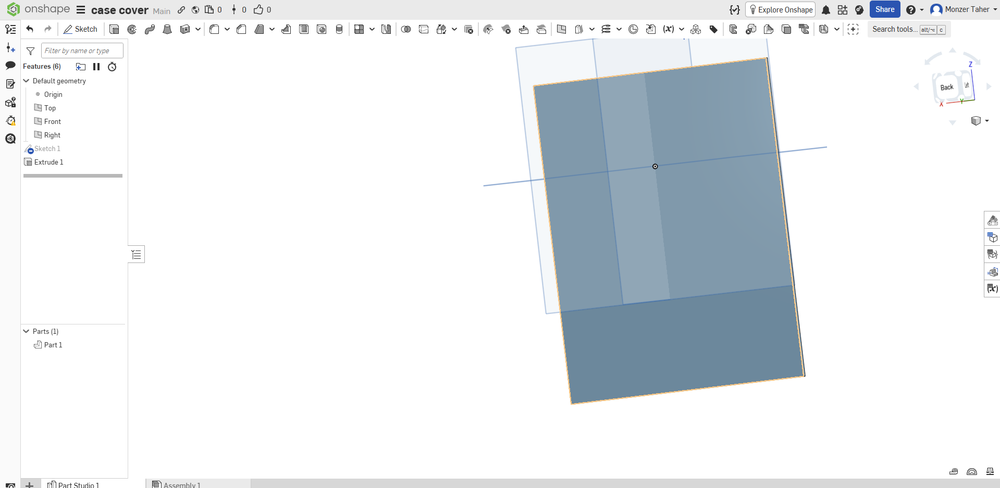
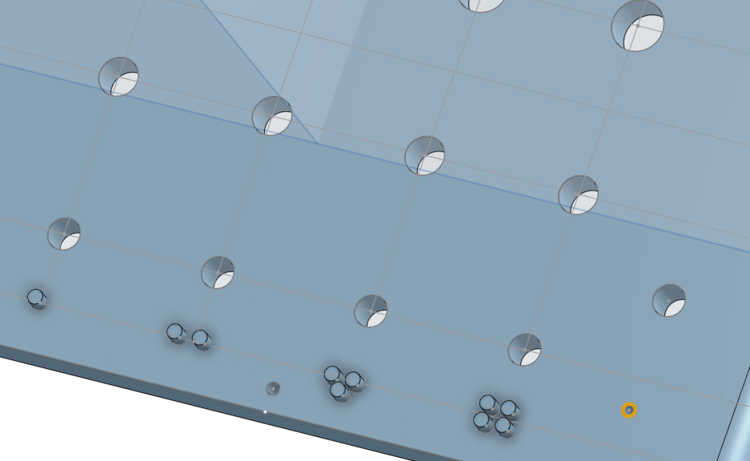
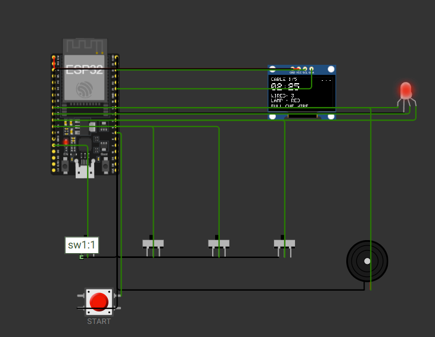
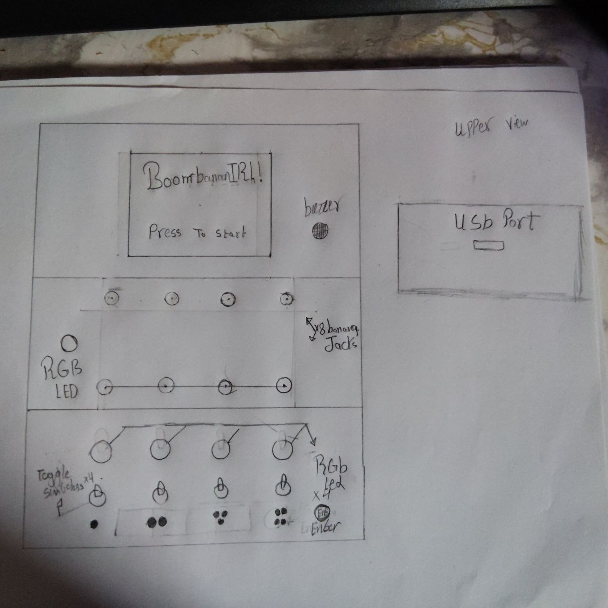

# BOMBANANA IRL

A physical, three-player version of the bomb-defusal mini-game from
**BOMBANANA!** — one player is blindfolded, one is deaf, one cannot speak, and
the bomb only goes quiet if all three of them work together.




*The current tub (`hardware/cad/final.stl`). Earlier concept sketches:*



> Fan project. **BOMBANANA!** is by Lefto Studio — this is not affiliated with
> them, and nothing here is copied from their assets.

---

## Play it

Double-click **`sim/index.html`** to play on this PC, or **`serve.bat`** to
serve the same game on your Wi-Fi (`http://<your-ip>:8080/`) so phones can
join. Controls and test scenarios: [`docs/SIMULATOR.md`](docs/SIMULATOR.md).

---

## Scope — what this repo is, and what it is not

This project covers **design and software only**:

| In scope | Out of scope (separate build project) |
|---|---|
| Game rules and player manual | Buying any part |
| ESP32 firmware (cable + switch modules) | 3D printing the case |
| Browser simulator of the same logic | Soldering / perfboard assembly |
| Case CAD — the tub in `hardware/cad/final.stl` | Adding the lid, standoffs, screen pocket |
| Wiring and mechanical documentation | Hardware testing on a real board |

Nothing has been purchased or printed for this repo. The firmware has **not**
run on real hardware yet — it is verified by building clean and by the
simulator in [`sim/`](sim/index.html) only (scenarios and controls:
[`docs/SIMULATOR.md`](docs/SIMULATOR.md)). The physical build is a separate,
later project, and [`hardware/TEST-PLAN.md`](hardware/TEST-PLAN.md) is the
hand-off checklist for it.

---

## Status

| Part | State |
|---|---|
| Game rules + paper prototype | ✅ done and playtested |
| Player manual (screen + sounds + faults) | ✅ [`docs/GAME-GUIDE.md`](docs/GAME-GUIDE.md) |
| Firmware: timer, strikes, buzzer, cable module | ✅ complete, builds clean |
| Firmware: switch module | ✅ complete, builds clean |
| Firmware: tested on hardware | ⬜ not yet — simulator-verified only |
| Case: shell (tub) | ✅ modelled — `hardware/cad/final.stl` |
| Case: lid | ⬜ out of scope for this repo |
| Case: internal mounts (standoffs, screen pocket) | ⬜ out of scope — see [`hardware/MOUNTS.md`](hardware/MOUNTS.md) |
| Hardware bought / printed | ⬜ out of scope — separate build project |

Firmware builds clean on `espressif32@6.12.0`: RAM 6.8 %, flash 23.6 %
(`firmware.bin` 309 841 bytes). The simulator runs the same tables
(`TABLE_3`, `TABLE_4`), the same 5-round plan (2 switch rounds) and the same
500 ms switch hold.

---

## How you play

Three roles, three handicaps, and nobody can see the whole problem:

| Player | Handicap | Can |
|---|---|---|
| 🙈 **Blind** | blindfolded | touch the bomb — the jacks, the switches, the raised dots |
| 🙉 **Deaf** | ear defenders | see the screen, the lamp colour, the indicator LEDs |
| 🙊 **Mute** | may not speak | read the manual, and only gesture |

The mute player reads the rule for this round, gestures it to the deaf player,
the deaf player shows it to the blind player, and the blind player pulls the
right wire before the timer hits zero.

**5 rounds, 3 strikes, 2:30 on the clock.**

### The cable round

1. The big RGB lamp shows a colour — **red**, **green** or **blue**.
2. Three or four wires are plugged into the banana jacks.
3. The manual maps that colour + wire count to a position.
4. The blind player pulls one wire. Wrong wire = strike.

Only the mute player knows the mapping, and they can't say it. That is the
whole game.

### The switch round

No pre-known pattern: the four toggles have to be flipped until the screen
reads `MATCH 4/4` and it holds for 500 ms. The green LEDs turn on per switch;
the deaf player is the only one who can see them.

---

## Hardware

| Part | Qty | Notes |
|---|---|---|
| ESP32 DevKit V1 (30-pin, USB-C) | 1 | one board runs everything |
| 2.4" ILI9341 SPI TFT (no touch) | 1 | timer + strikes, window 48.95 × 36.70 mm |
| Banana jack JS-910B | 8 | 4 signal + 4 GND, panel holes Ø8.19 |
| 4 mm banana plug | 8 | one per pullable wire |
| Mini toggle ON/OFF | 4 | GPIO 34/35/36/39, external 10 kΩ pull-ups |
| 5 mm LED | 5 | 1 common-cathode RGB + 4 green |
| Passive buzzer module | 1 | must be **passive** — active ones can't play tones |
| Perfboard 8 × 12 cm | 1 | all wiring lives here, no PCB in v1 |
| JST-XH connectors | — | modules plug in, nothing is soldered to the case |
| Start button (momentary, 12 mm) | 1 | GPIO 33 — without it the game cannot start |
| Resistor 1k + capacitor 100nF (×4 each) | 8 | ESD protection on the jack signal lines |

Full bill of materials with prices and purchase links:
**[`BOM.csv`](BOM.csv)** — total **$175.23** including tools. It is a **cost
estimate only**; no order has been placed.

Every dimension, hole and tolerance:
**[`hardware/MECHANICAL.md`](hardware/MECHANICAL.md)**.
Wiring map: **[`hardware/WIRING.md`](hardware/WIRING.md)**.
Mounting reference: **[`hardware/MOUNTS.md`](hardware/MOUNTS.md)**.

### Pin map

| Signal | GPIO |
|---|---|
| Jack 1 / 2 / 3 / 4 | 13 / 14 / 16 / 17 |
| Switch 1 / 2 / 3 / 4 | 34 / 35 / 36 / 39 |
| Socket indicator LEDs ×4 | 4 / 21 / 22 / 12 |
| RGB lamp R / G / B | 25 / 26 / 27 |
| Buzzer | 32 |
| Start button | 33 |
| TFT CS / DC | 5 / 2 |
| TFT MOSI / MISO / SCK | 23 / 19 / 18 |
| TFT RST | none — tied to 3V3 |

`GPIO12` is a strapping pin and must be low at boot; it drives an LED through a
resistor to ground, which is exactly what it wants. `GPIO15` is deliberately
unused. The switch pins are **input-only** and have no internal pull-up, so the
10 kΩ resistors are mandatory, not optional.

The jacks are read with `INPUT_PULLUP`: a plugged wire shorts the pin to ground.
Every input is debounced for 30 ms, and a pulled wire is latched once so that
grabbing two wires at the same time only counts as one cut.

---

## Building the firmware

Needs [PlatformIO](https://platformio.org/).

```bash
pio run            # build
pio run -t upload  # flash
```

On Windows you can also double-click `build.bat`, which retries if the USB
connection drops.

TFT_eSPI is configured entirely through `build_flags` in `platformio.ini` —
there is no edited `User_Setup.h` to forget about.

---

## Repo layout

```
src/main.cpp              firmware — game state machine, display, audio
platformio.ini            board + TFT_eSPI pin configuration
build.bat                 Windows build helper (retries on USB drop)
serve.bat                 serve sim/ on your Wi-Fi so phones can play
tools/serve.ps1           the server behind serve.bat (Python 3 http.server)
BOM.csv                   every part, price and link + TOTAL
hardware/MECHANICAL.md    measured dimensions of final.stl, hole table, gaps
hardware/MOUNTS.md        mounting reference (Arabic): depth budget, bosses
hardware/WIRING.md        full wiring map (the diagram for the perfboard build)
hardware/TEST-PLAN.md     hand-off checklist for the separate build project
hardware/cad/README.md    which STL is which, and what is not in the model
hardware/cad/final.stl    the current tub — one shell, no lid, no mounts
hardware/cad/case_final.stl  empty 12-triangle placeholder — not a model
docs/GAME-GUIDE.md        the player-facing manual (tables match the firmware)
docs/QUICK-RULES.md       one-page rules sheet (Arabic) for the table
docs/SIMULATOR.md         how to run sim/ and what to test in it
sim/index.html            browser simulator — runs the actual game logic
images/                   paper prototype + early Onshape screenshots
JOURNAL.md                build log (hours per day)
PLAN.md                   working plan (Arabic)
```

---

## Future work

- Test the firmware on real hardware (see `hardware/TEST-PLAN.md`)
- Lid with a seating rim and lugs — build project
- Screen pocket, board standoffs, cable clips — build project
- Custom PCB — v2, the perfboard is a v1 compromise
- DFPlayer Mini for real voice lines and explosion audio
- Direction and Calculation modules, to match the full game

---

## License

MIT — see [`LICENSE`](LICENSE).
